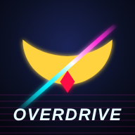
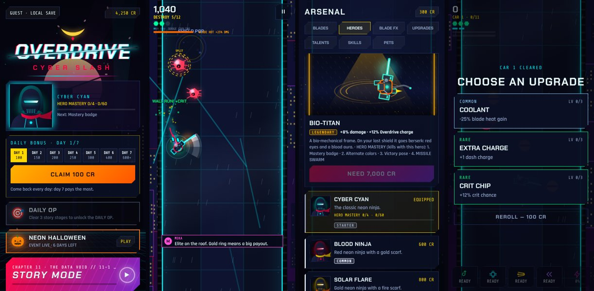
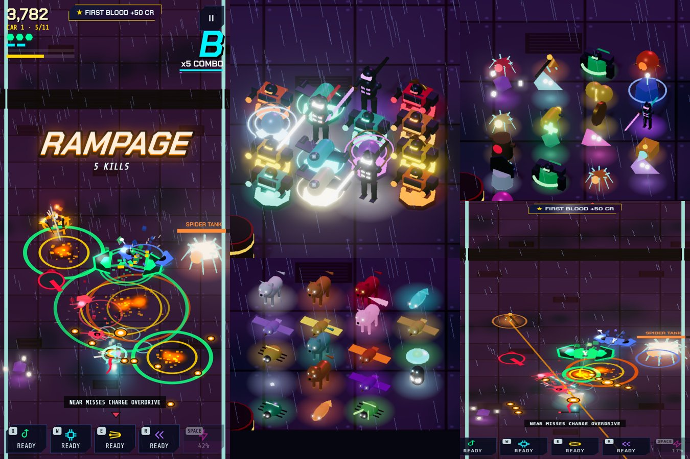
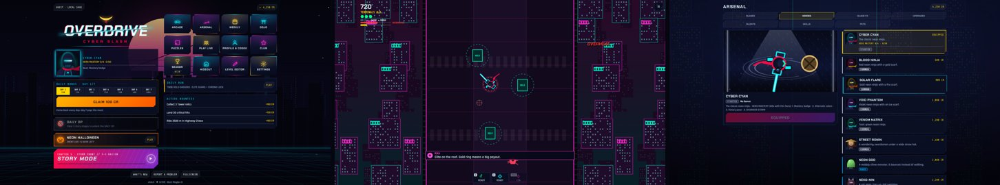

# OVERDRIVE: CYBER SLASH

**משחק אקשן נינג'ה סייברפאנקי — לזנק, לחתוך ולהדוף על גגות ניאו־אדו.**
*A neon cyberpunk ninja action game — dash, slash and parry across the rooftops of Neo Edo.*

### [▶ לשחק עכשיו / Play now](https://undertaker132.github.io/overdrive-ninja/)

[⭐ לתת ביקורת / Leave a review](https://github.com/undertaker132/overdrive-ninja/issues/new?template=feedback.yml) ·
[🐞 לדווח על באג / Report a bug](https://github.com/undertaker132/overdrive-ninja/issues/new?template=bug.yml) ·
[💡 להציע רעיון / Suggest an idea](https://github.com/undertaker132/overdrive-ninja/issues/new?template=idea.yml)

---

## 🇮🇱 עברית

### איך מתקינים את האפליקציה
המשחק עובד ישר מהדפדפן, וגם אפשר להתקין אותו כאפליקציה לכל דבר (אייקון במסך הבית, מסך מלא, עובד גם בלי אינטרנט):

| מכשיר | איך מתקינים |
|---|---|
| **אנדרואיד** (Chrome) | פותחים את [הקישור](https://undertaker132.github.io/overdrive-ninja/) ← לוחצים על **התקנת האפליקציה** במסך הפתיחה של המשחק, או בתפריט ⋮ ← **התקנת אפליקציה** / **הוספה למסך הבית** |
| **אייפון / אייפד** (Safari) | פותחים את הקישור ב-Safari ← כפתור השיתוף ⬆️ ← **הוספה למסך הבית** |
| **מחשב** (Chrome / Edge) | פותחים את הקישור ← אייקון ההתקנה בצד ימין של שורת הכתובת |

### מה יש במשחק
- **מצב סיפור** — 8 מערכות, יותר מ-70 שלבים, דיאלוג מדובב, בוסים עם כניסות ונפילות משלהם, קומיקס בין הפרקים ו-New Game+.
- **ארקייד** — Maglev אינסופי, התקפת בוסים, מגדל רוגלייט, מרדף על אופנוע, אתגר יומי ושבועי, פאזלים ודוג'ו.
- **ארסנל** — עשרות להבים, גיבורים, סקינים לחרבות, חיות מחמד ועץ שדרוגים.
- **חברים** — משחק חי עם חברים, רוחות (ghosts) של שיאים, ריפליי וקליפים, צוותים ועורך שלבים.
- **תלת־ממד אמיתי** (מנוע three.js): מודלים מוארים עם צללים לגיבור, לאויבים, לבוסים ולחיות, גג רכבת רטוב שמשקף את הניאון והעיר למטה. אפשר גם תלת־ממד קלאסי או דו־ממד.
- תמיכה בשלט (Xbox / PlayStation / Switch), עברית, ערבית, רוסית ואנגלית.

### נתתם ביקורת? תודה! 🙏
המשחק בפיתוח, וכל משוב עוזר:
- **מתוך המשחק:** מסך הפתיחה ← **דיווח על בעיה** ← כותבים ← **פתיחה ב-GitHub**. נפתח דיווח מוכן עם פרטי המכשיר.
- **מכאן:** [ביקורת ומשוב](https://github.com/undertaker132/overdrive-ninja/issues/new?template=feedback.yml) · [באג](https://github.com/undertaker132/overdrive-ninja/issues/new?template=bug.yml) · [רעיון](https://github.com/undertaker132/overdrive-ninja/issues/new?template=idea.yml)

(צריך חשבון GitHub חינמי כדי לשלוח.)

---

## 🇬🇧 English

### Install it as an app
The game runs straight in the browser and can also be installed as a real app (home-screen icon, full screen, works offline):

| Device | How |
|---|---|
| **Android** (Chrome) | Open the [link](https://undertaker132.github.io/overdrive-ninja/) → tap **INSTALL APP** on the title screen, or ⋮ menu → **Install app** / **Add to Home screen** |
| **iPhone / iPad** (Safari) | Open the link in Safari → Share ⬆️ → **Add to Home Screen** |
| **Desktop** (Chrome / Edge) | Open the link → the install icon at the right of the address bar |

### What's inside
- **Story** — 8 acts, 70+ stages, voiced dialogue, bosses with their own entrances and falls, comics between chapters, New Game+.
- **Arcade** — endless Maglev Run, boss rush, a rogue-lite tower, a highway chase, daily and weekly challenges, puzzles and a training dojo.
- **Arsenal** — dozens of blades, heroes, blade skins, pets and an upgrade tree.
- **Social** — live play with friends, ghost runs, replays and clips, crews and a level editor.
- **Real 3D** (three.js engine): lit, shadowed models for the hero, enemies, bosses and pets, a wet train roof that reflects the neon, and the city far below. Classic 3D and 2D are still there.
- Gamepad support, English, Hebrew, Arabic and Russian.

### Controls
| | Touch | Keyboard / mouse | Gamepad |
|---|---|---|---|
| Dash-slash | drag & release, or tap | drag & release with the mouse | left stick + A (hold LT for slow-motion aim) |
| Skills | buttons at the bottom | Q W E R | X · Y · B · LB |
| Overdrive | ⚡ button | Space | RB |
| Pause | ‖ button | Esc | START |

### On a computer

- **Mouse:** hold to aim at the cursor (time slows), release to slash. Right click dodges, the wheel swaps weapons, the middle button is Overdrive. A crosshair shows your dash charges.
- **Keyboard only:** arrows aim, hold SHIFT for the slow-motion aim, C slashes, V dodges. Every key can be rebound in **Settings → PC & DISPLAY → KEYS**. Arrows, ENTER and ESC work in the menus; ALT+ENTER is fullscreen.
- **High refresh rate:** smooth motion on 120 to 480 Hz screens, a frame-rate limit (MAX, 480, 360, 240, 165, 144, 120, 90, 60) and render resolution (75% to 200%).
- **Wide roof:** on a landscape screen the story, the dojo and your own levels play on a roof almost twice as wide. Ranked modes keep the standard roof.
- Two-column home screen and Arsenal, controller rumble and button prompts, and the game pauses when you switch windows.

### Feedback
- **In the game:** title screen → **REPORT A PROBLEM** → write → **OPEN ON GITHUB**. A ready report with your device info opens.
- **Here:** [review](https://github.com/undertaker132/overdrive-ninja/issues/new?template=feedback.yml) · [bug](https://github.com/undertaker132/overdrive-ninja/issues/new?template=bug.yml) · [idea](https://github.com/undertaker132/overdrive-ninja/issues/new?template=idea.yml) (a free GitHub account is needed).

---

## For the developer

The whole game is one self-contained file, [`index.html`](index.html) (no build step, no dependencies). Around it:

| File | What it does |
|---|---|
| `manifest.webmanifest` | makes the page installable (name, icons, full screen) |
| `sw.js` | offline cache: network first for the game, cache for icons and fonts |
| `icons/` | app icons (`icon.svg` is the source) |
| `.github/ISSUE_TEMPLATE/` | the review, bug and idea forms |
| `desktop/` | the desktop app (Electron) for Windows, macOS and Linux |
| `.github/workflows/release.yml` | builds the desktop apps and the itch.io web zip |
| `docs/STORE.md` | store page text, tags, screenshot list and how to publish on itch.io / Steam |

**Publishing (one time):** repository **Settings → Pages → Build and deployment → Source: Deploy from a branch → Branch: `main` / `(root)` → Save.**
After a minute the game is live at `https://undertaker132.github.io/overdrive-ninja/`. Every push to `main` updates it.

**Desktop apps (Windows / macOS / Linux):** push a tag such as `v35.0` (`git tag v35.0 && git push origin v35.0`). GitHub Actions builds the installers and the itch.io zip and attaches them to a release. To build on your own computer: `cd desktop && npm install && npm run dist`. The apps are not code-signed, so Windows SmartScreen and macOS Gatekeeper show a warning the first time (on a Mac: right click → Open).

**Run locally:** `python3 -m http.server` in this folder, then open <http://localhost:8000>. (Opening the file directly also works, without the offline cache.)

Saves stay on the player's device (local storage). Cloud saves, leaderboards and the creator dashboard only work in the claude.ai version of the game.

---

The 3D view uses [three.js](https://threejs.org) r160 (MIT License, Copyright 2010-2023 three.js authors), bundled inside `index.html`.
