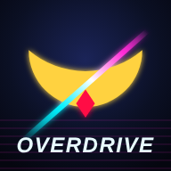
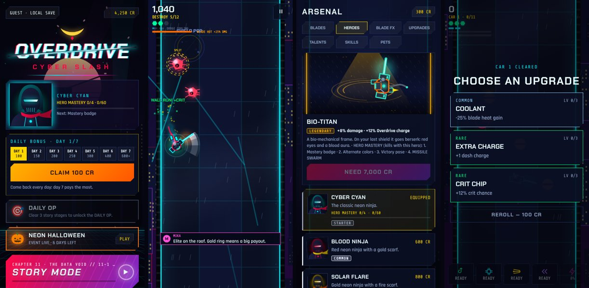
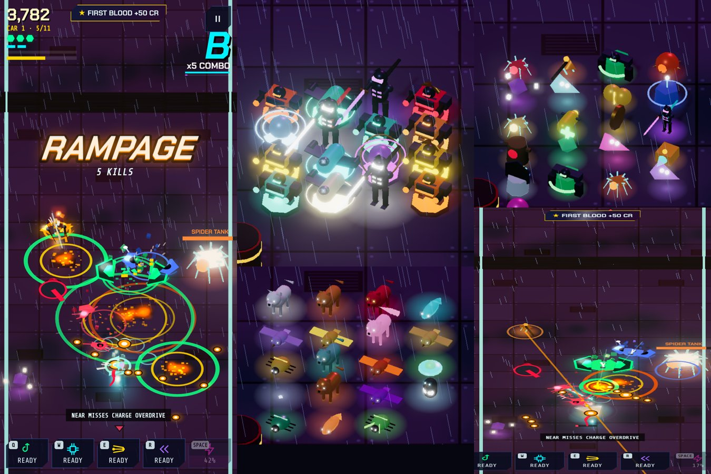
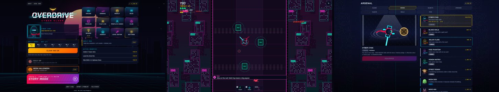

# OVERDRIVE: CYBER SLASH

**משחק אקשן נינג'ה סייברפאנקי — לזנק, לחתוך ולהדוף על גגות ניאו־אדו.**
*A neon cyberpunk ninja action game — dash, slash and parry across the rooftops of Neo Edo.*

### [▶ לשחק עכשיו / Play now](https://undertaker132.github.io/overdrive-ninja/)

[⭐ לתת ביקורת / Leave a review](https://github.com/undertaker132/overdrive-ninja/issues/new?template=feedback.yml) ·
[🐞 לדווח על באג / Report a bug](https://github.com/undertaker132/overdrive-ninja/issues/new?template=bug.yml) ·
[💡 להציע רעיון / Suggest an idea](https://github.com/undertaker132/overdrive-ninja/issues/new?template=idea.yml)

---

## 🇮🇱 עברית

### איך מתקינים את האפליקציה
המשחק עובד ישר מהדפדפן, וגם אפשר להתקין אותו כאפליקציה לכל דבר (אייקון במסך הבית, מסך מלא, עובד גם בלי אינטרנט):

| מכשיר | איך מתקינים |
|---|---|
| **אנדרואיד** (Chrome) | פותחים את [הקישור](https://undertaker132.github.io/overdrive-ninja/) ← לוחצים על **התקנת האפליקציה** במסך הפתיחה של המשחק, או בתפריט ⋮ ← **התקנת אפליקציה** / **הוספה למסך הבית** |
| **אייפון / אייפד** (Safari) | פותחים את הקישור ב-Safari ← כפתור השיתוף ⬆️ ← **הוספה למסך הבית** |
| **מחשב** (Chrome / Edge) | פותחים את הקישור ← אייקון ההתקנה בצד ימין של שורת הכתובת |

### חדש בגרסה 88.0 (ZENITH EDITION)
- **עולם תלת־ממדי חי** — רכבים מעופפים בין גורדי השחקים, זרקורי משטרה סורקים את השמיים, ברקים ורעמים בשלבי סערה ומסילות ניאון פועמות לפי הבס של המוזיקה.
- **מולטי־סלאש אוברקלוק ומתקפת זאנשין** — חיסול 3+ אויבים בזינוק אחד מפעיל קווי קונסטלציה, +1 זינוק ואוברדרייב; פארי מושלם טוען מתקפת זאנשין (+50% נזק).
- **3 נשקים אקזוטיים חדשים** — PLASMA ODACHI (גלי פלזמה הממיסים כדורים), CYBER KUSARIGAMA (משיכה מגנטית וברק שרשרת) ו-CHRONO GLAIVE (שדה הקפאת זמן בקפיצה מקיר).
- **אקולייזר חי, 3 שירים חדשים וטלמטריה** — ZENITH OVERDRIVE, CYBER REQUIEM ו-NEO-EDO DRIFT 2099, אקולייזר ספקטרום חי, באנר אזהרת שלבי בוסים ופיד קרב טקטי.

### חדש בגרסה 87.0 (SYMPHONY & ANIMATION OVERHAUL)
- **6 שירים חדשים וסאונד משודרג** — CYBER SAKURA, HYPER KATANA, NEON RONIN, ECLIPSE PROTOCOL, MIDNIGHT DOJO ו-PRISM OVERDRIVE בחדר המוזיקה ובריצות, לצד פנפארים מוזיקליים לתיבות, צליל שליפת חרב בכיוון ו-Foley משודרג.
- **שדרוג אנימציות פתיחת תיבות וכל המשחק** — טבעות אנרגיה מסתובבות, בניית מתח, התפרצות כוכבים בחשיפה, מתיחה וכיווץ בזינוק/נחיתה, הטיית גוף בפניות ורתע קפיצי לאויבים.
- **6 סקיני גיבורים חדשים, 4 להבים וצבעים משודרגים** — PRISM RONIN, SOLAR SERAPH, CYBER KITSUNE, OBSIDIAN SHOGUN, EMERALD PHANTOM, ASTRAL ONI ולהבי פריזמה/אקליפס/ירקן/נובה, לצד תאורת סטודיו וצבעי ממשק משודרגים.

### חדש בגרסה 86.0 (APEX EDITION)
- **פריימי אימפקט בסגנון אנימה** — הוצאות להורג, פארי מושלם ושבירת שלבי בוס מפעילים פריימי אימפקט חדים עם קווי מהירות רדיאליים.
- **שובלי חיתוך תלת־ממדיים וצלקות גג** — בתלת־ממד כל זינוק חורט שובל אנרגיה באוויר וצלקת ניאון לוהטת על הגג הרטוב, לצד גלי הלם, אדוות גשם ותאורת אוברדרייב דינמית.
- **כיוון טקטי וטבעת קרב** — תצוגה מקדימה של חיסולים, הוצאות להורג וכדורים להדיפה על קו הזינוק (כולל קפיצה מקיר), חצי איום מחוץ למסך, וטבעת מטענים/חום סביב הגיבור.
- **צעד רפאים (Phantom Step) ואודיו דינמי** — כמעט־פגיעות ברגע האחרון מחזירות זינוק ואוברדרייב, דרגות SS/SSS מאיצות טעינה, ההילוך האיטי מעמעם את הפסקול והקומבו מצלצל בהרמוניות פלדה עולות.

### מה יש במשחק
- **מצב סיפור** — 8 מערכות, יותר מ-70 שלבים, דיאלוג מדובב, בוסים עם כניסות ונפילות משלהם, קומיקס בין הפרקים ו-New Game+.
- **ארקייד** — Maglev אינסופי, התקפת בוסים, מגדל רוגלייט, מרדף על אופנוע, אתגר יומי ושבועי, פאזלים ודוג'ו.
- **תיבות, כור היתוך ואבולוציה** — תיבות ניאון עם סרט פתיחה לכל דרגת נדירות (הסיכויים מוצגים, בלי כסף אמיתי), להבים אגדיים ומיתיים מתיבות או מכור ההיתוך, ואבולוציה לנשקים ולגיבורים.
- **אחרי הסוף** — דרגת שחקן מברונזה ועד אגדה, אחוז השלמה, כתרי בוסים לכל רמת קושי, מסלול כוכבים, בוס השבוע וגיבורים שאפשר רק להרוויח.
- **קרב קולנועי** — הוצאה להורג לאויבי עילית פצועים (זנקו דרכם מתחת ל־30% חיים), כניסת אוברדרייב עם הגיבור שלכם על כל המסך, ומצלמת בוס שמקיפה אותו בכניסה ומתקרבת בנפילה.
- **ארסנל** — עשרות להבים, גיבורים, סקינים לחרבות, חיות מחמד ועץ שדרוגים.
- **חברים** — משחק חי עם חברים: המארח מקבל קוד של 6 ספרות והחברים מקלידים אותו, וכל חבר מופיע על הגג כנינג׳ה בצבעים שלו. בנוסף רוחות (ghosts) של שיאים, ריפליי וקליפים, צוותים ועורך שלבים.
- **תלת־ממד אמיתי** (מנוע three.js): מודלים מוארים עם צללים לגיבור, לאויבים, לבוסים ולחיות, גג רכבת רטוב שמשקף את הניאון והעיר למטה. אפשר גם תלת־ממד קלאסי או דו־ממד.
- תמיכה בשלט (Xbox / PlayStation / Switch), ג׳ויסטיק כיוון על המסך (בהגדרות), בחירת רזולוציה, עברית, ערבית, רוסית ואנגלית.

### נתתם ביקורת? תודה! 🙏
המשחק בפיתוח, וכל משוב עוזר:
- **מתוך המשחק:** מסך הפתיחה ← **דיווח על בעיה** ← כותבים ← **פתיחה ב-GitHub**. נפתח דיווח מוכן עם פרטי המכשיר.
- **מכאן:** [ביקורת ומשוב](https://github.com/undertaker132/overdrive-ninja/issues/new?template=feedback.yml) · [באג](https://github.com/undertaker132/overdrive-ninja/issues/new?template=bug.yml) · [רעיון](https://github.com/undertaker132/overdrive-ninja/issues/new?template=idea.yml)

(צריך חשבון GitHub חינמי כדי לשלוח.)

---

## 🇬🇧 English

### Install it as an app
The game runs straight in the browser and can also be installed as a real app (home-screen icon, full screen, works offline):

| Device | How |
|---|---|
| **Android** (Chrome) | Open the [link](https://undertaker132.github.io/overdrive-ninja/) → tap **INSTALL APP** on the title screen, or ⋮ menu → **Install app** / **Add to Home screen** |
| **iPhone / iPad** (Safari) | Open the link in Safari → Share ⬆️ → **Add to Home Screen** |
| **Desktop** (Chrome / Edge) | Open the link → the install icon at the right of the address bar |

### What's inside
- **Story** — 23 chapters, 85 stages up to the giant oni king, voiced dialogue, bosses with their own entrances and falls, comics between chapters, New Game+.
- **Arcade** — endless Maglev Run, boss rush, a rogue-lite tower, a highway chase, daily and weekly challenges, puzzles and a training dojo.
- **Crates, the forge and evolution** — neon crates with an opening film for every rarity (odds shown, no real money), legendary and mythic blades from crates or the forge, and evolution for blades and heroes.
- **After the credits** — a player rank from Bronze to Legend, a completion %, boss crowns for every difficulty, a star road, a boss of the week and heroes you can only earn.
- **Cinematic combat** — executions for wounded elites (dash through them below 30% health), an Overdrive cut-in with your hero across the screen, and a boss camera that circles them as they arrive and pushes in as they fall.
- **Arsenal** — dozens of blades, heroes, blade skins, pets and an upgrade tree.
- **Social** — live play with friends (the host gets a 6-digit code, friends type it in, and each friend is a ninja in their own colors on your roof), ghost runs, replays and clips, crews and a level editor.
- **Real 3D** (three.js engine): lit, shadowed models for the hero, enemies, bosses and pets, a wet train roof that reflects the neon, and the city far below. Classic 3D and 2D are still there.
- Gamepad support, an optional on-screen aim joystick, a resolution setting, English, Hebrew, Arabic and Russian.

### Controls
| | Touch | Keyboard / mouse | Gamepad |
|---|---|---|---|
| Dash-slash | drag & release, or tap | drag & release with the mouse | left stick + A (hold LT for slow-motion aim) |
| Skills | buttons at the bottom | Q W E R | X · Y · B · LB |
| Overdrive | ⚡ button | Space | RB |
| Pause | ‖ button | Esc | START |

### On a computer

- **Mouse:** hold to aim at the cursor (time slows), release to slash. Right click dodges, the wheel swaps weapons, the middle button is Overdrive. A crosshair shows your dash charges.
- **Keyboard only:** arrows aim, hold SHIFT for the slow-motion aim, C slashes, V dodges. Every key can be rebound in **Settings → PC & DISPLAY → KEYS**. Arrows, ENTER and ESC work in the menus; ALT+ENTER is fullscreen.
- **High refresh rate:** smooth motion on 120 to 480 Hz screens, a frame-rate limit (MAX, 480, 360, 240, 165, 144, 120, 90, 60). Sharpness: **Settings → SCREEN → RESOLUTION** (AUTO, MAX, HIGH, MEDIUM, LOW).
- **Wide roof:** on a landscape screen the story, the dojo and your own levels play on a roof almost twice as wide. Ranked modes keep the standard roof.
- Two-column home screen and Arsenal, controller rumble and button prompts, and the game pauses when you switch windows.

### Feedback
- **In the game:** title screen → **REPORT A PROBLEM** → write → **OPEN ON GITHUB**. A ready report with your device info opens.
- **Here:** [review](https://github.com/undertaker132/overdrive-ninja/issues/new?template=feedback.yml) · [bug](https://github.com/undertaker132/overdrive-ninja/issues/new?template=bug.yml) · [idea](https://github.com/undertaker132/overdrive-ninja/issues/new?template=idea.yml) (a free GitHub account is needed).

---

## For the developer

The game is a static page: [`index.html`](index.html) loads `css/overdrive.css`, `js/three-r160.min.js` (3D), `js/game-core.js` (the game) and `js/overdrive-aaa.js` (the v96+ upgrade modules). Nothing to install to play or to build.

**Change the game:** edit the files in `source/`, then run `python3 source/build.py`. It joins them into the two scripts in `js/` and names the offline cache in `sw.js` after the version (`VERSION` in `source/src/10-config.js`). `python3 source/build.py --check` only checks that the scripts match the source. `--artifact DIR` also writes the one-page copy used on claude.ai.

**Test it:** `node tests/run.js` (needs Node and Playwright with Chromium; ESLint for the lint step). It runs:
- `replay`: bot runs in every mode that records replays, each compared tick by tick with its own replay;
- `compat`: replays recorded on older versions (`tests/fixtures/`, made with `node tests/record-fixture.js <build folder> <out.json>`) must give the same score on this one;
- `pace`: a new player starts with the newer systems and the heat pact closed, and they open as the story goes on;
- `ghost`: the daily saves your best attempt of the day as a ghost, and the next daily races it;
- `voice`: story lines, the radio and the announcer never cut each other off, and each character gets a voice of their gender;
- `story`: a bot that knows every objective plays one stage of each kind to STAGE CLEAR and its results screen;
- `sweep`: every arcade mode and one story stage per chapter played in real time in 2D and 3D, with no errors allowed.

`node source/lint.js` is the code check. GitHub runs all of it on every push and pull request (`.github/workflows/tests.yml`).

**Replays and old versions:** a rule that changes the simulation must be gated with `simV(<version>)`, so replays recorded before it still play the old way, and that version must be listed in `SIM_COMPAT` (`source/src/10-config.js`). Add a fixture recorded on the new version to `tests/fixtures/` when you release.

| File | What it does |
|---|---|
| `source/src/` | the core game, one file per system, joined in name order into `js/game-core.js` |
| `source/aaa/` | the upgrade modules (v96 and later), joined in name order into `js/overdrive-aaa.js` |
| `source/build.py`, `source/lint.js` | the build and the ESLint check |
| `tests/` | the browser tests and the recorded replays |
| `lang/` | Arabic and Russian dictionaries (edited in place, loaded only when chosen) |
| `audio/` | optional music tracks (`tracks.json` lists them; see `PUT_TRACKS_HERE.txt`) |
| `css/`, `js/` | the stylesheet and the built scripts |
| `manifest.webmanifest` | makes the page installable (name, icons, full screen) |
| `sw.js` | offline cache: network first for the game, cache for icons and fonts |
| `icons/` | app icons (`icon.svg` is the source) |
| `.github/ISSUE_TEMPLATE/` | the review, bug and idea forms |
| `desktop/` | the desktop app (Electron) for Windows, macOS and Linux |
| `.github/workflows/release.yml` | builds the desktop apps and the itch.io web zip |
| `.github/workflows/tests.yml` | runs the build check, lint and browser tests on every push |
| `docs/STORE.md` | store page text, tags, screenshot list and how to publish on itch.io / Steam |

**Publishing (one time):** repository **Settings → Pages → Build and deployment → Source: Deploy from a branch → Branch: `main` / `(root)` → Save.**
After a minute the game is live at `https://undertaker132.github.io/overdrive-ninja/`. Every push to `main` updates it.

**Desktop apps (Windows / macOS / Linux):** push a tag such as `v35.0` (`git tag v35.0 && git push origin v35.0`). GitHub Actions builds the installers and the itch.io zip and attaches them to a release. To build on your own computer: `cd desktop && npm install && npm run dist`. The apps are not code-signed, so Windows SmartScreen and macOS Gatekeeper show a warning the first time (on a Mac: right click → Open).

**Run locally:** `python3 -m http.server` in this folder, then open <http://localhost:8000>. (Opening the file directly also works, without the offline cache.)

Saves stay on the player's device (local storage). Cloud saves, leaderboards and the creator dashboard only work in the claude.ai version of the game. Live play works everywhere: with a 6-digit code the two phones find each other through public MQTT relays (EMQX, HiveMQ, Eclipse Mosquitto, Eclipse Foundation) and then connect directly (WebRTC); what passes through the relays is encrypted with a key made from the code. The long code / QR way needs no relay at all.

---

The 3D view uses [three.js](https://threejs.org) r160 (MIT License, Copyright 2010-2023 three.js authors), bundled inside `index.html`.

## Credits for the 3D models
- Robot: "RobotExpressive" by Tomás Laulhé (Quaternius), CC0 1.0.
- Fox: model by PixelMannen (CC0), rigging and animation by tomkranis (CC BY 4.0), glTF conversion by @AsoboStudio and @scurest (CC BY 4.0).
- Hero bodies: "X Bot" and "Soldier" from Mixamo (Adobe), free to use in games.
- Sword animations: "KayKit Character Animations" by Kay Lousberg, CC0.
- Monsters (orc, demons): Quaternius "Ultimate Monsters", CC0.
- Sound effects: Kenney audio packs (Impact Sounds, RPG Audio, Sci-Fi Sounds, Digital Audio, Music Jingles), CC0.
- three.js r160 and its GLTFLoader / SkeletonUtils (MIT License).

---
## v89.0 — SAKUGA & CINEMA MASTERWORK
- **Full 16-Bone Anime Skeletal Combat Choreography (`SakugaRig89`)**: 6-hit combo (`Iaido Draw`, `Kesagiri`, `Rising Fang`, `Cyclone 360°`, `X-Scissor`, `Kabuto Vault Slam`), Iaido crouch focus stance, Parry Guard pose, idle Chiburi flourish, dual-blade & heavy variants, and smooth velocity corner banking.
- **3D Volumetric Slash Arcs, Sandevistan Clones & Zandatsu Bisection (`SakugaVFX89`)**: 3D curved crescent slash ribbons, chromatic Sandevistan afterimages, split-in-half 3D/2D enemy deaths, and 3D enemy hit-recoil & attack anticipation.
- **Cinema 3D Lighting, Reflections & Post-FX (`Cinema3D89`)**: Procedural Cyber-Neon IBL EnvMap (`PMREMGenerator`), Embossed Wet Normal-Mapped Train Roof, 4-light pooled Dynamic 3D Impact Flash Lights, Style-Reactive Rim Lighting, Chromatic Aberration RGB Split, and Low-HP Heartbeat Vignette.
- **Kinetic Action Camera & Speedlines (`KineticCam89`)**: Spring-damped dash zoom-punch, Iaido focus tighten, directional impact kick, and anime radial speedlines.
- **Next-Gen Gacha Crate Shatter (`CrateSakuga89`)**: Expanding energy cracks, 3-frame anime shatter flash, and tumbling prismatic shards.
- **DMC Style Rank Badge (`StyleRank89`) + Adaptive Spatial Audio (`AudioCinema89`)**: Animated `D → SSS` badge, Spatial Stereo Panning (`StereoPannerNode`), adaptive music filter, Iaido/robot-vs-demon/rank-up Foley, 2 new flagship tracks (`SANDEVISTAN PULSE`, `BLADE OF ETERNITY`), and rain white-noise permanently silenced.

---
## v90.0 — PC EDITION (DESKTOP MASTERWORK)
- **Full PC Twin-Action Controls (`PCMaster90`)**: Free **WASD** movement with smooth inertia and arena clamping, **Instant Left-Click Slash** straight toward the cursor, **Hold Right-Click Iaido Focus** (slow-motion aim) / **Quick Right-Click Dodge**, **Shift** directional dodge, **1–4** instant skill hotkeys, **Tab / Mouse Wheel** weapon swap, **Space** Overdrive, and **F11 / Alt+Enter** Fullscreen.
- **True Widescreen & Ultrawide PC Arena + Mouse Lookahead (`PCWide90`)**: Dynamically expands the playable train roof up to **820px** across Story, Arcade, Endless, Boss Rush, Dojo & Custom modes on desktop screens, paired with a smooth mouse-lead lookahead camera.
- **Reactive Target-Lock Cyber Reticle, Hotkey Bar & Live Telemetry (`PCHud90`)**: Cursor reticle snaps a rotating neon lock-on diamond + enemy HP arc over hovered targets, accompanied by a sleek desktop hotkey strip and live **FPS / frame-time (ms)** monitor for high-refresh-rate PC displays.
- **Desktop UI & Ultra Graphics Polish (`PCUltra90`)**: Wider desktop menu grids (`980px`), crisp button hover micro-physics, custom neon scrollbars, auto-Ultra graphics preset on PC, and a dedicated **PC EDITION (v90)** settings section in 4 languages.

---
## v91.0 — LEGENDARY ANIME OVERHAUL (FINAL MASTERWORK)
- **2D-to-3D Anime Visual Overhaul (`AnimeToon91`)**: Unified 3-step `MeshToonMaterial` Cel-Shading across Heroes, Enemies, and Bosses, crisp Anime Ink Outlines (black standard, glowing gold for Elites, thick crimson/black for Bosses), vibrant 2D-matched skin palette & iconic blade silhouettes, plus a live toggle in Settings (`ANIME 2D-STYLE` vs `CYBER METALLIC`).
- **Overdrive Anime Cut-In & Judgment Ultimate Finisher (`CutIn91`)**: Dramatic horizontal anime Cut-In banner with hero eyes & typography on Overdrive activation + Judgment Cut screen-wide slash storm.
- **Interactive Boss Blade Clash (`BladeClash91`)**: Close-range sword clash duel against bosses with flying sparks, slow-motion tension, and a mashable clash meter that shatters the boss's guard for massive bonus damage.
- **Dynamic Train Roof Set-Pieces (`SetPieces91`)**: Living world events including **Neon Tunnel Blackout**, **Laser Gateway** (with `PHASE THROUGH! +OD` dash bonus), and **Parallel Express** train pass-bys.
- **Awakened Weapon Evolutions (`Awakened91`)**: Reaching 20+ combo awakens your blade with a radiant golden aura and chain-lightning shockwaves every 3rd dash.
- **Shadow Rival Invasion (`ShadowRival91`) & Dojo Combo Lab (`DojoLab91`)**: Surprise dark mirror ninja invasions with huge rewards, plus a full Dojo training HUD with live DPS, Peak DPS, Infinite Overdrive toggle, and Parry Dummy spawner.

---
## v92.0 — ASCENSION & PRODUCTION MASTERWORK
- **Asset Splitting & Fast-Boot Optimization**: Extracted the ~607 KB inline Arabic & Russian dictionaries into lazy-loaded `lang/ar.js` and `lang/ru.js` modules (works over both HTTPS and local `file://`).
- **Roguelike Build Synergies (`Synergies92`)**: 4 Hades-style set evolutions (`STORM CONDUIT`, `CRIMSON VAMPIRE`, `CHRONO PHANTOM`, `OVERCLOCK PROTOCOL`) with live HUD badges.
- **Tactical Enemy Squad AI (`SquadAI92`)**: Coordinated **Aegis Links** (Brutes shielding nearby Snipers for 50% DR) and **Drone Overclock Links** (speed-boosting nearby melee units).
- **Ascension / Heat Pact System (`HeatPact92`)**: 5 stackable pre-run Heat Contracts (`HYPER BOSSES`, `ELITE SQUADS`, `BULLET STORM`, `FRAGILE FRAME`, `CRIMSON VELOCITY`) with +15% score multiplier per Heat level.
- **Playtest Clarity & Balance (`Clarity92`)**: High-contrast incoming bullet halos & balanced Blade Clash pacing.
- **Publish-Ready Online Cloud Leaderboard & Save Sync (`CloudReady92` + `DEPLOY.md`)**: Plug-and-play Firebase Realtime DB global leaderboard, local Top-10 fallback, Save Export/Import codes, and full GitHub Pages / itch.io deployment guide.

---
## v94.0 — AAA CINEMATIC CRATE OVERHAUL (`CrateCinema94`)
- **Interactive 3D Crate Stage**: Dedicated Three.js studio scene with reflective cyber pedestal, orbiting energy rings, 3D splitable cyber-armored crate, and a volumetric **Sky Beam** erupting upward.
- **Slash-to-Open Gesture**: Swipe across the 3D crate with your mouse or finger (or press `Space` / click) to draw a glowing katana trail, trigger a 3-frame anime Hitstop, and physically **bisect the 3D crate into two flying halves**.
- **Rarity Fake-Out Surprises**: High-rarity crates (Epic / Legendary / Mythic) can start in a lower rarity color, freeze with a glitch & heartbeat riser, and violently shatter into their true glowing rarity.
- **Audio Ducking & Signature Rarity Fanfares**: Music ducks before impact so the slice, sub-bass drop, and rarity synth chord hit at full power.
- **Multi-Slash (`OPEN ×5`)**: Open up to 5 crates in one swipe with a headline 3D showcase and a clean Multi-Crate Haul summary grid.
